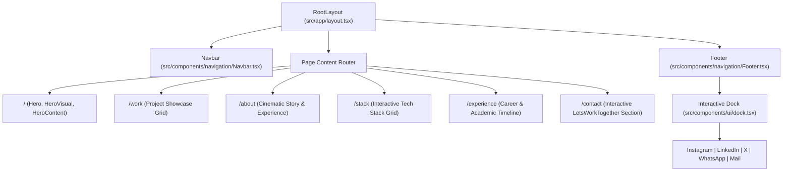

# 🚀 Hitesh's Portfolio

<div align="center">

  [](https://itshitesh.vercel.app/)
  [](https://nextjs.org/)
  [](https://react.dev/)
  [](https://www.typescriptlang.org/)
  [](https://tailwindcss.com/)
  [](https://www.framer.com/motion/)

  <p align="center">
    A high-performance, dark-themed, cinematic developer portfolio crafted with fluid animations, macOS-inspired magnification physics, and interactive experiences.
  </p>

  <p align="center">
    <a href="#-quick-start">Quick Start</a> •
    <a href="#-architecture--routes">Architecture</a> •
    <a href="#-interactive-components">Key Components</a> •
    <a href="#-featured-projects">Featured Projects</a> •
    <a href="#-tech-stack">Tech Stack</a> •
    <a href="#-environment-variables">Env Config</a> •
    <a href="#-license">License</a>
  </p>

</div>

---

## ⚡ Quick Start

Get the development environment up and running in under a minute.

### 1. Prerequisites
- **Node.js**: `v20.x` or higher
- **Package Manager**: `npm`, `pnpm`, or `bun`

### 2. Clone & Install
```bash
# Clone the repository
git clone https://github.com/Hitesh-09/portfolio.git
cd portfolio

# Install dependencies
npm install
```

### 3. Configure Environment
```bash
cp .env.example .env.local
```
*(Optional)* Add your [Web3Forms Access Key](https://web3forms.com/) for contact form submissions:
```env
NEXT_PUBLIC_WEB3FORMS_ACCESS_KEY=your_access_key_here
```

### 4. Run Development Server
```bash
npm run dev
```

Open [http://localhost:3000](http://localhost:3000) to view the live site in your browser with Turbopack instant hot reloading.

---

## 🧭 Architecture & Routes



<details>
<summary>📂 <strong>Click to expand full repository structure</strong></summary>

```text
portfolio/
├── public/                 # Static assets (images, project screenshots, resume.pdf)
│   ├── projects/           # Featured project preview thumbnails
│   └── resume.pdf          # Downloadable curriculum vitae
├── src/
│   ├── app/                # Next.js 16 App Router pages
│   │   ├── about/          # About page & personal narrative
│   │   ├── contact/        # Contact page with interactive form
│   │   ├── experience/     # Interactive career timeline
│   │   ├── stack/          # 24-skill animated tech grid
│   │   ├── work/           # Curated project showcase
│   │   ├── globals.css     # Tailwind CSS v4 styling rules
│   │   ├── layout.tsx      # Root layout (Navbar, Footer, Geist fonts)
│   │   └── page.tsx        # Cinematic Hero entrypoint
│   ├── components/
│   │   ├── about/          # About narrative components
│   │   ├── hero/           # Hero visual canvas & interactive text
│   │   ├── navigation/     # Floating Navbar & Dynamic Dock Footer
│   │   ├── stack/          # Interactive tech stack card grid
│   │   ├── ui/             # Reusable primitives (Dock, ProjectCard, Button, Form)
│   │   └── work/           # Work & project layout components
│   └── lib/
│       └── utils.ts        # clsx & tailwind-merge helper (cn utility)
├── .env.example            # Sample environment variables
├── next.config.ts          # Next.js build & static export config
├── package.json            # Scripts & project dependencies
├── tsconfig.json           # TypeScript strict configuration
└── README.md               # Project documentation
```

</details>

---

## 🎨 Interactive Components

| Component | Path | Description |
|---|---|---|
| **Physics-Based Dock** | [`src/components/ui/dock.tsx`](src/components/ui/dock.tsx) | Inspired by macOS dock. Uses Framer Motion's `useMotionValue`, `useTransform`, and `useSpring` to dynamically calculate mouse distance and smoothly scale icons on proximity. |
| **"Let's Work Together" Section** | [`src/components/ui/lets-work-section.tsx`](src/components/ui/lets-work-section.tsx) | Interactive contact module featuring expand/collapse card animations, live Web3Forms integration, phone, and email links. |
| **Interactive Tech Stack** | [`src/components/stack/InteractiveStack.tsx`](src/components/stack/InteractiveStack.tsx) | Staggered 24-technology badge grid with 3D hover elevations, backdrop blur, and vendor logos via DevIcons CDN. |
| **Project Showcase Card** | [`src/components/ui/project-card.tsx`](src/components/ui/project-card.tsx) | Clean glassmorphic cards with subtle borders, dynamic image overlays, tag chips, and direct GitHub links. |

---

## 💼 Featured Projects

Explore the highlighted projects featured directly in the portfolio:

| Project | Description | Tech Stack | Repository |
|---|---|---|:---:|
| **EduLink** | Academic study collaboration & resource-sharing platform for SRMIST peers with doubts forum & PYQs. | Next.js, Express, Supabase, Tailwind | [Code](https://github.com/Hitesh-09/Edulink) |
| **ParamSetu** | Parametric insurance solution providing instant, automated micro-payouts for gig delivery riders. | Python, FastAPI, Web3, Smart Contracts | [Code](https://github.com/Hitesh-09/ParamSetu) |
| **Retinal Disease Classifier** | Deep learning convolutional neural network pipeline for diagnostic scan classification. | PyTorch, Computer Vision, FastAPI | [Code](https://github.com/Hitesh-09/retinal-disease-classification) |
| **AgentGuard** | Security, auditing, and observability gateway designed specifically for autonomous AI agents & LLMs. | Python, LangChain, REST APIs | [Code](https://github.com/Hitesh-09/Agentguard) |
| **KrishiMitra** | Scalable farmer data management platform providing agri-analytics and real-time farmer advisory. | Node.js, Express, PostgreSQL | [Code](https://github.com/Hitesh-09/KrishiMitra) |
| **TrainMate** | Smart mobile assistant for railway schedules, live seat tracking, and route optimization. | React Native / Flutter, REST APIs | [Code](https://github.com/Hitesh-09/TrainMate) |

---

## 🛠️ Tech Stack

<div align="center">

```
Frontend Architecture       Animation & Physics         Tooling & Infrastructure
┌────────────────────┐      ┌────────────────────┐      ┌────────────────────────┐
│  Next.js 16 (App)  │      │  Framer Motion 13  │      │  Turbopack Compiler    │
│  React 19.2        │      │  Spring Dynamics   │      │  TypeScript 5 Strict   │
│  Tailwind CSS v4   │      │  Mouse Proximity   │      │  Vercel CI/CD Pipeline │
│  Geist Sans & Mono │      │  Lucide SVG Icons  │      │  Web3Forms API         │
└────────────────────┘      └────────────────────┘      └────────────────────────┘
```

</div>

---

## 💻 Available Scripts

| Command | Action |
|---|---|
| `npm run dev` | Starts local development server on [http://localhost:3000](http://localhost:3000) using Turbopack |
| `npm run build` | Builds optimized production bundle with static route prerendering |
| `npm run start` | Starts a production server after building |
| `npm run lint` | Runs ESLint 9 to verify code standards and type safety |

---

## ⚙️ Environment Variables

Create a `.env.local` file in the root directory:

```env
# Web3Forms API Key for contact form email routing (Optional)
NEXT_PUBLIC_WEB3FORMS_ACCESS_KEY="your_access_key_here"
```

---

## 📬 Contact & Connect

- **Portfolio**: [itshitesh.vercel.app](https://itshitesh.vercel.app/)
- **LinkedIn**: [linkedin.com/in/hitesh45](https://www.linkedin.com/in/hitesh45/)
- **GitHub**: [@Hitesh-09](https://github.com/Hitesh-09)
- **Twitter / X**: [@Hiteish79](https://x.com/Hiteish79)
- **Instagram**: [@eyem.hitesh](https://www.instagram.com/eyem.hitesh/)
- **WhatsApp**: [+91 80551 81811](https://wa.me/918055181811)
- **Email**: [hiteishshimpi@gmail.com](mailto:hiteishshimpi@gmail.com)

---

## 📄 License

This project is licensed under the [MIT License](LICENSE) — feel free to explore, fork, and learn from it.
